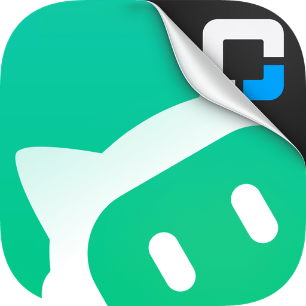

<p align="center">
  
</p>

<h1 align="center">OMC WorkBuddy OAuth</h1>

<p align="center">
  <a href="https://github.com/WizisCool/oh-my-cpa">
    <picture>
      <source media="(prefers-color-scheme: dark)" srcset="https://raw.githubusercontent.com/WizisCool/oh-my-cpa/main/web/src/assets/brand/omc-wordmark-dark.svg">
      
    </picture>
  </a>
</p>

<p align="center">
  Native WorkBuddy and WorkBuddy AI OAuth login for
  <a href="https://github.com/router-for-me/CLIProxyAPI">CLIProxyAPI</a>
</p>

<p align="center">
  <a href="https://github.com/omc-community/omc-workbuddy-oauth/releases"></a>
  <a href="https://github.com/omc-community/omc-workbuddy-oauth/actions/workflows/build.yml"></a>
  
  
</p>

<p align="center">
  <a href="README.md">English</a> · <a href="README.zh-CN.md">简体中文</a>
</p>

OMC WorkBuddy OAuth adds the `workbuddy` provider to CLIProxyAPI. Sign in with a
WorkBuddy account from your panel's OAuth flow, and CPA gains the account's own
model list, OpenAI-compatible chat execution and normalized quota, with no
separate process and no local WorkBuddy desktop client.

The plugin is developed and maintained as part of the
[Oh-My-CPA](https://github.com/WizisCool/oh-my-cpa) ecosystem, the self-hosted
control plane and usage console for CLIProxyAPI.

## Two builds, one provider

WorkBuddy ships as two builds with separate accounts on separate hosts. Both
produce the same credential (`"type": "workbuddy"`) and share one executor, so the
plugin registers two OAuth login entries instead of one entry plus a build
dropdown.

| Build | Login entry | API host |
| --- | --- | --- |
| WorkBuddy (China) | `workbuddy` | `https://copilot.tencent.com` |
| WorkBuddy AI (international) | `workbuddy-ai` | `https://www.workbuddy.ai` |

On a panel that renders per-entry metadata (CPA v8.0.51+) each entry appears as its
own card with its own name and mark. On an older host both identifiers still work,
and the panel shows the plugin's own name and logo for them.

- Pick the build by picking its entry. The entry wins over any `site` hint.
- Each credential records the build that signed it in, as `site` and as the
  credential's `oauth_provider`.
- `site` (default `workbuddy`) is only the fallback for a login request that names
  no entry, such as a host that starts a login under the plugin identifier alone.
- An explicit but invalid `site` value is rejected rather than silently resolved.

## Panel-agnostic by design

Everything user-facing is rendered by the host: the OAuth tiles, config fields,
static assets and quota views all go through CPA's plugin ABI and management API.
The plugin is first-class in [Oh-My-CPA](https://github.com/WizisCool/oh-my-cpa)
and works the same in CPA's own Management Center or any other panel that speaks
CPA's management API.

OAuth starts and polling use CPA's authenticated management API. Public plugin
resources contain only three static marks and the optional description declaration:
`logo.png`, `workbuddy.svg`, `codebuddy-color.svg` and `omc.json`. A request to those
routes cannot start a flow, and a query parameter never triggers an action.

Sign-in is the browser flow WorkBuddy's own desktop uses. The plugin asks
WorkBuddy for a sign-in page, opens the page Tencent serves for that build, polls
the same flow for the token and reads the account it belongs to. No local callback
listener and no manual callback URL submission is required. A desktop sign-in is
not available: the plugin runs inside CPA on a server and reads no client files.

## Features

- WorkBuddy and WorkBuddy AI OAuth, one login entry per build.
- Token refresh with WorkBuddy's rotating refresh token, one exchange at a time per
  credential; an enterprise (team) account carries its `X-Enterprise-Id` and
  `X-Tenant-Id` on every request.
- Model discovery from the build's `/v3/config`, lowercased for CPA routing, with a
  shipped fallback list when the config cannot be read.
- OpenAI chat completions in and out, streaming and non-streaming, including tool
  calls, reasoning content, image inputs and usage. WorkBuddy streams every chat, so
  a non-streaming request is answered from the stream read out.
- Request shaping the endpoint expects: `max_tokens` instead of
  `max_completion_tokens`, `system` instead of `developer`, WorkBuddy's default
  system message, `reasoning` instead of `reasoning_content`, and the model's own
  default reasoning level when the client names none.
- WorkBuddy's request ids — conversation, turn, message — derived from the chat, so
  one user send stays one request in the account's usage detail.
- Normalized quota from the billing meter, split the way WorkBuddy's own panel
  splits it: the plan's credits, extra credits, the account's total, and any prepaid
  balance, with the plan's reset read from the package meter beside that summary.
- Plan-aware model listing: a model WorkBuddy refuses as not included in the
  account's plan is hidden from that credential for an hour instead of being offered
  and refused again.
- Per-credential concurrency control.
- Import of existing `"type": "workbuddy"` auth files.
- Error mapping that keeps a lapsed sign-in, an entitlement, a rate limit and an
  unapproved-channel refusal on their own status codes instead of folding them into
  a generic upstream failure. A rate limit's message names when the allowance comes
  back (`… 2026-11-02 19:17:02 UTC+8`), and that instant is handed to CPA as the
  cooldown, so a limited model rests until WorkBuddy itself says it may run again.

## Installation

Add this repository as a plugin-store source:

```yaml
plugins:
  enabled: true
  dir: /path/to/plugins
  store-sources:
    - https://raw.githubusercontent.com/omc-community/omc-plugins/main/official.json
  configs:
    omc-workbuddy-oauth:
      enabled: true
```

Then install `omc-workbuddy-oauth` from the plugin store and open its OAuth tile in
your panel. The store and shared-library name is `omc-workbuddy-oauth`; the CPA
credential provider identifier remains `workbuddy`. See
[docs/USAGE.md](docs/USAGE.md) for login, configuration, quota and
troubleshooting.

Releases are created by GitHub Actions whenever a `v*` tag is pushed.

## Configuration

| Field | Type | Default | Values |
| --- | --- | --- | --- |
| `site` | enum | `workbuddy` | Fallback build when a login request names no entry: `workbuddy`, `workbuddy-ai` |
| `max_concurrency` | integer | `3` | 1–100 requests per credential |
| `app_version` | string | `5.9.3` | WorkBuddy desktop version the client claims in its `User-Agent` |
| `cli_version` | string | `2.165.0` | WorkBuddy CLI version the client claims |

WorkBuddy refuses a chat whose `User-Agent` does not start `WorkBuddy/<version>`
(error `10085`), so the two version fields are configuration rather than constants:
a vendor build bump does not need a new release.

## Development

The plugin implementation lives in [`go/`](go/). Tests run without network access
after modules are downloaded:

```sh
cd go
go mod download
GOPROXY=off GOSUMDB=off go test ./...
GOPROXY=off GOSUMDB=off go vet ./...
```

A local native build for the current machine:

```sh
cd go
CGO_ENABLED=1 go build -buildmode=c-shared -o ../build/omc-workbuddy-oauth.so .
```

Use `.dylib` on macOS and `.dll` on Windows. `build/` is ignored by git.

The release workflow builds these artifacts from a tag:

```text
omc-workbuddy-oauth_<version>_linux_amd64.zip
omc-workbuddy-oauth_<version>_linux_arm64.zip
omc-workbuddy-oauth_<version>_darwin_amd64.zip
omc-workbuddy-oauth_<version>_darwin_arm64.zip
omc-workbuddy-oauth_<version>_windows_amd64.zip
omc-workbuddy-oauth_<version>_windows_arm64.zip
checksums.txt
omc-workbuddy-oauth.omc.json
```

Each archive contains the correctly named `omc-workbuddy-oauth.so`,
`omc-workbuddy-oauth.dylib` or `omc-workbuddy-oauth.dll` at its root.
`checksums.txt` covers every archive, and the plugin store verifies the archive it
downloads against it. `omc-workbuddy-oauth.omc.json` is the optional description
declaration described in [docs/USAGE.md](docs/USAGE.md); the bytes it publishes are
the same bytes the plugin embeds and serves.

See [CONTRIBUTING.md](CONTRIBUTING.md) for commit conventions, test expectations,
and ecosystem development standards.

## Project layout

```text
assets/logo.png             Plugin sticker: the plugin's face in a store
assets/workbuddy.svg        WorkBuddy mark for the China build's sign-in entry
assets/codebuddy-color.svg  CodeBuddy mark for the WorkBuddy AI entry
go/                      Go/cgo plugin implementation and tests
go/assets/               Embedded artwork and the omc.json declaration
docs/USAGE.md            Operator installation and usage guide
```

The Go implementation is independent. Protocol provenance, including the
sign-in flow, the request headers and the chat shaping, is recorded in
[NOTICE.md](NOTICE.md).

## License

[MIT](LICENSE)
